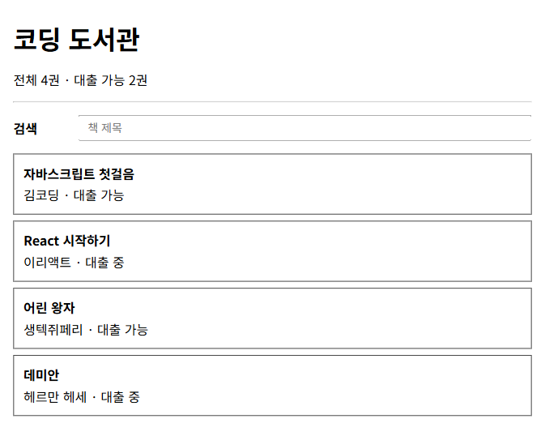
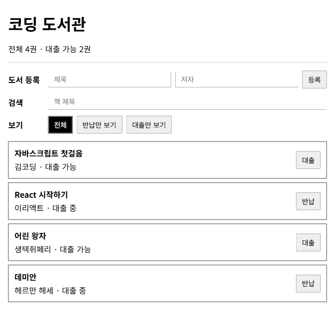
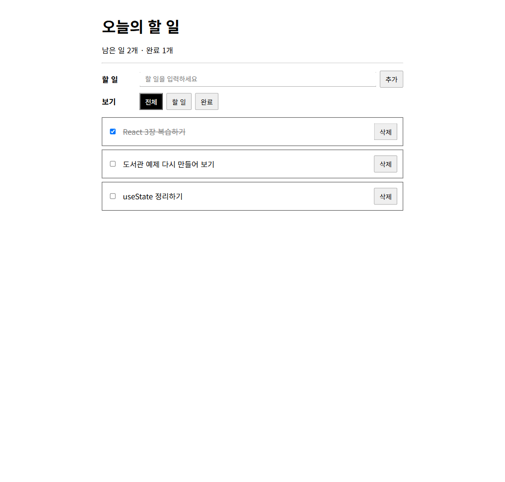
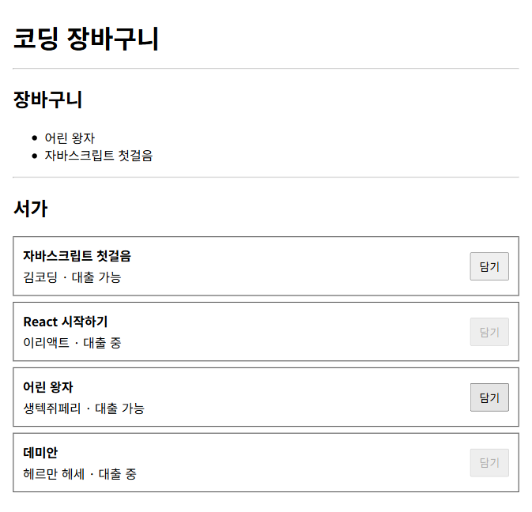
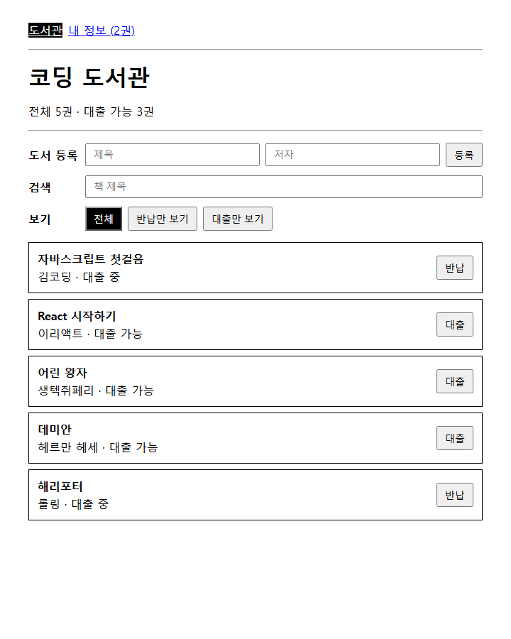

# React 예제

React 강의에서 쓰는 장별 예제 코드다.
모든 예제는 src/examples 아래 폴더 하나씩 있다.

## 예제 목록

| 폴더 | 장 | 내용 |
|---|---|---|
| 04-state | 4장 | 도서관 책 목록, 대출 가능 권수, 제목 검색 (useState) |
| 05-component | 5장 | 4장 도서관을 컴포넌트로 나누고 책 추가, 대출 토글, 필터 더하기 (props) |
| ex1-todo | 실습 1 | 할 일 추가, 완료 토글, 삭제, 필터 |
| ex2-cart | 실습 2 | 책장에서 책을 골라 장바구니에 담기 (useContext 없이 props로) |
| 12-zustand | 12장 | 도서관 상태를 zustand 스토어로 옮기고 내 페이지 화면 더하기 (react-router) |

## 실행

```
npm install
npm run dev
```

http://localhost:5173 에서 본다.
보여 줄 예제는 src/App.jsx 의 import 를 바꿔서 고른다.

```jsx
import LibraryApp from "./examples/12-zustand/LibraryApp.jsx";
```

| 폴더 | 시작 컴포넌트 |
|---|---|
| 04-state | Library.jsx |
| 05-component | Library.jsx |
| ex1-todo | TodoApp.jsx |
| ex2-cart | Cart.jsx |
| 12-zustand | LibraryApp.jsx |

## 화면

4장 도서관



5장 컴포넌트로 나눈 도서관



실습 1 할 일



실습 2 장바구니



12장 zustand 도서관



장 중간 과정 사진은 captures 폴더에 있다.
